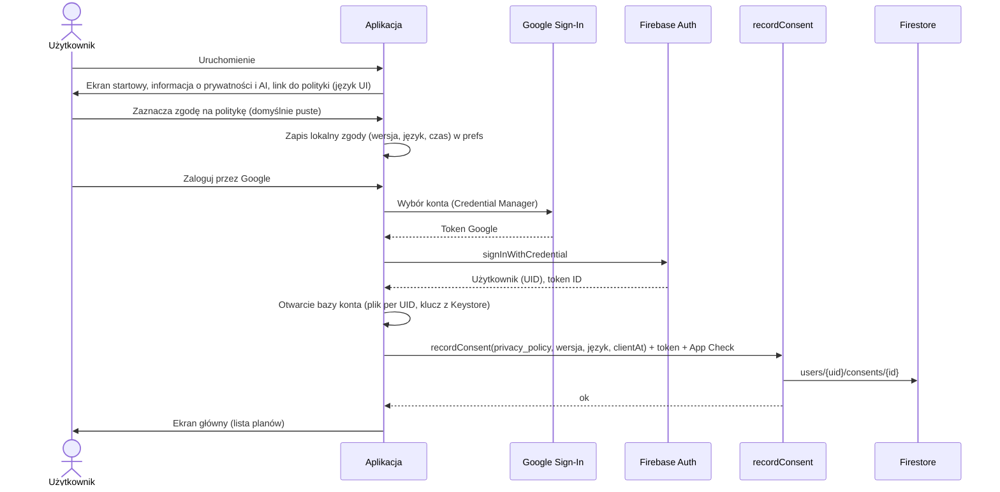
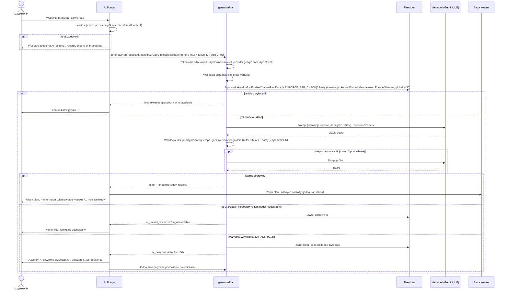
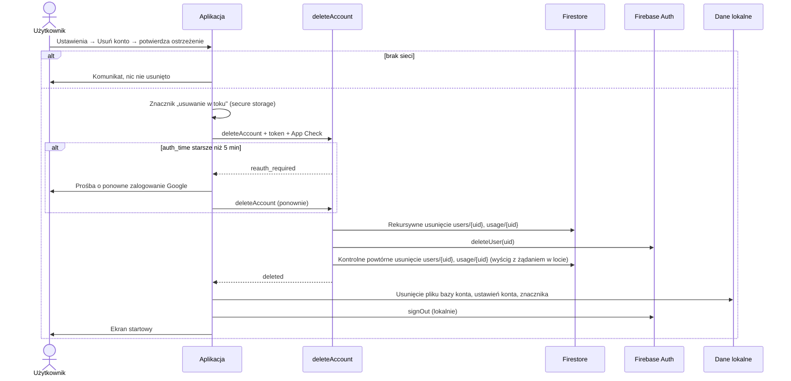

# Przepływy – Tamitu (MVP)

Stan: 2026-11-15 (po G2, ADR zatwierdzone; uwzględnione Aneksy A). Powiązane: `overview.md`, ADR-0002, 0004, 0005, 0007 (lokalizacja zastąpiona przez ADR-0017), `docs/api/posrednik-api.md`.

## 1. Pierwsze uruchomienie i logowanie (US-001, US-003)


Błędy: anulowanie u dostawcy → powrót na ekran startowy bez błędu technicznego; brak sieci → komunikat i ponowienie; niepowodzenie `recordConsent` → kolejka ponowień (zgoda lokalna zachowana), a `generatePlan` zwróci `consent_required`, co wymusza synchronizację przed generowaniem.

## 2. Generowanie planu (US-004, US-005, US-006, US-011)


Ponowienia na serwerze po 429 (do 3 wywołań, najwyżej 2 płatne, odczekanie 2–4 s i 4–8 s, budżet 100 s) i kod `ai_busy` opisuje ADR-0016 (zatwierdzony; warunek Billing spełniony 2026-11-24).
Anulowanie: aplikacja przerywa oczekiwanie i nic nie zapisuje lokalnie; slot limitu pozostaje zużyty, jeśli wywołanie modelu już ruszyło (ADR-0002, Q12 zatwierdzone). Dane formularza zostają w pamięci ekranu do powrotu.
Wycofanie zgody AI (ADR-0002, Aneks A pkt 4): aplikacja zapisuje `recordConsent(granted=false)` przed pokazaniem stanu „wycofano"; bez sieci – komunikat, generowanie zablokowane lokalnie do synchronizacji.

## 3. Link Google Maps (US-007; ADR-0017, wariant C)

```mermaid
sequenceDiagram
  actor U as Użytkownik
  participant A as Aplikacja (maps_link)
  participant GM as Google Maps (aplikacja lub przeglądarka)

  U->>A: Dotyka punktu planu
  A->>U: Wybór startu (moja lokalizacja / nocleg / poprzedni punkt) i trybu (auto, komunikacja, pieszo)
  alt start = moja lokalizacja
    A->>A: Budowa URL maps/dir/?api=1&destination&travelmode (bez origin)
  else start = nocleg lub poprzedni punkt
    A->>A: Budowa URL z origin = tekst z planu
  end
  A->>GM: Otwarcie linku (LaunchMode.externalApplication)
  Note over GM: Bez origin Mapy ustawiają start „Twoja lokalizacja”; o zgodę na lokalizację pytają Mapy, nie Tamitu
  Note over A: Tamitu nie ma uprawnień lokalizacji i nie odczytuje pozycji; link nie jest zapisywany
```
Obowiązuje wariant C (ADR-0017, decyzja właściciela 2026-11-25, Q1 = C; zastępuje wariant A z ADR-0007). `destination` zawsze jako tekst „nazwa, miejscowość, cel podróży”, nigdy same współrzędne. Gdy Mapy nie mają zgody lub lokalizacja jest wyłączona, Mapy same proszą o zgodę albo pokazują pusty start do wybrania (test TAM-24).

## 4. Usunięcie konta i danych (US-010)


Przerwanie po stronie serwera → ponowienie jest bezpieczne (idempotentne). Zabicie aplikacji po sukcesie serwera → przy starcie znacznik „w toku" wymusza dokończenie czyszczenia lokalnego. Logi techniczne (skrót UID) wygasają w 30 dni (S7). Dane innych kont na urządzeniu pozostają (N3). Dowód zgód jest usuwany razem z kontem (Q9). Wywołanie `recordConsent`/`generatePlan` starym tokenem po usunięciu zwraca `unauthenticated` i nie tworzy dokumentów (ADR-0002, Aneks A pkt 1).

## 5. Wylogowanie (US-002)
Aplikacja zamyka bazę bieżącego konta, wykonuje `signOut` Google i Firebase, wraca na ekran startowy. Plany zostają zaszyfrowane na urządzeniu w pliku konta (N3); drugie konto otwiera własny plik (US-008).
