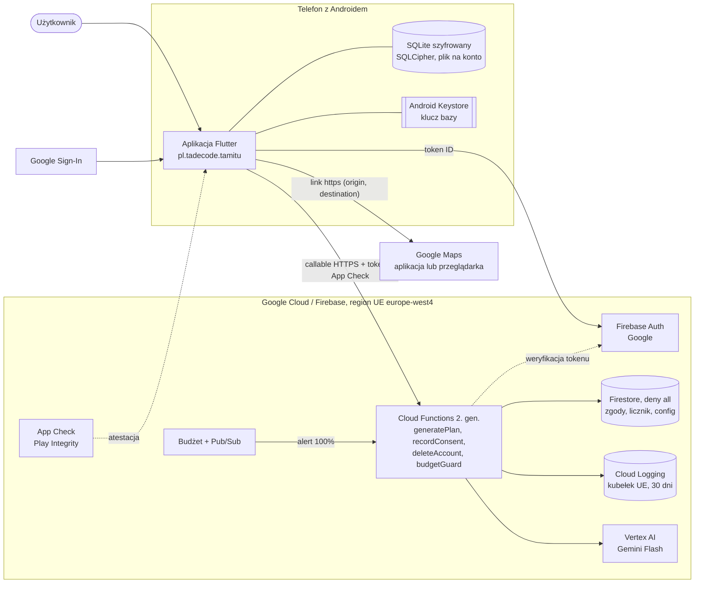

# Architektura Tamitu – przegląd (MVP, apka testowa na Androida)

Stan: 2026-11-15, wersja 0.2, status: **zatwierdzone na bramce G2 (2026-11-15)**; ADR-0001..0008 mają status „zatwierdzony" i zawierają Aneks A z wymaganiami z przeglądu Security. Autor: architect.
Decyzje: ADR-0001..0008 w `docs/adr/`.

Zmiany w wersji 0.2 (po G2): odpowiedzi właściciela Q1–Q12 (m.in. opcja A lokalizacji z testem C w fazie 3, minSdk 26, SQLCipher, doba kalendarzowa, dowód zgód usuwany z kontem); cztery konta usług (po jednym na funkcję); sprawdzanie istnienia użytkownika po tokenie; globalny handler wyjątków; reguła `ENFORCE_APP_CHECK`/`ALLOW_REAL_DATA`; ceny modeli oznaczone jako niezweryfikowane. Przepływy: `flows.md`. Koszty: `costs.md`. Dane: `docs/data/`. API: `docs/api/`. Uwagi i pytania: `uwagi-dla-orchestratora.md`.

## 1. Kontekst i zasady
- Flutter (Android, `pl.tadecode.tamitu`), Firebase i Google Cloud w UE (`europe-west4`), plany **tylko lokalnie**, AI przez pośrednika, logowanie wyłącznie Google, PL + EN.
- Zasady: najprostsze rozwiązanie; minimalizacja danych (do AI nie idą UID, e-mail, lokalizacja, numer lotu); brak sekretów w aplikacji; wszystko, co kosztuje lub jest wrażliwe, egzekwowane po stronie serwera; serwer zwraca kody, nie teksty.
- Poza MVP (bez projektu): reklamy, subskrypcje, zdjęcia/TTS, synchronizacja w chmurze, „w pobliżu", iOS, dodatkowi dostawcy logowania.

## 2. Diagram kontekstu i komponentów

Granice zaufania (zgodnie z `threat-model.md`): G-A urządzenie, G-B Auth, G-C aplikacja→pośrednik (wejście niezaufane), G-D pośrednik→model (odpowiedź niezaufana), G-E link Maps.

## 3. Moduły aplikacji Flutter (`lib/`, korzeń repozytorium; ADR-0009)
Podział „feature-first"; w każdej funkcji warstwy `presentation` (widgety, kontrolery Riverpod), `domain` (modele, reguły, interfejsy), `data` (implementacje: Drift, funkcje chmurowe). Zależności tylko do wewnątrz (presentation → domain ← data).

| Moduł | Odpowiada za | Historyjki | Zależności zewnętrzne |
|---|---|---|---|
| `lib/app/` | start aplikacji, motyw, router (`go_router`) i strażnicy tras (zgody → logowanie → ekran główny), flavory | wszystkie | – |
| `core/config` | środowisko dev/prod, stałe limitów walidacji (zgodne z `docs/api/`) | US-004, US-011 | – |
| `core/l10n` | ARB PL/EN, wybór języka, formaty | US-003..011 | `intl` |
| `core/errors` | mapowanie kodów błędów serwera i sieci na komunikaty (klucze l10n) | US-011 | – |
| `core/logging` | logger wydania: no-op; debug bez danych użytkownika; zakaz treści | T7 | – |
| `features/consent` | ekran startowy z polityką, zgoda na AI, Ustawienia → Prywatność, wersje tekstów, kolejka `recordConsent` | US-003 | `cloud_functions`, prefs |
| `features/auth` | logowanie Google, wylogowanie, stan sesji, ponowne uwierzytelnienie | US-001, US-002 | `firebase_auth`, `google_sign_in` |
| `features/trip_form` | formularz podróży, walidacja, oczyszczanie, wartości domyślne (N11) | US-004, US-006 | – |
| `features/plan_generation` | wywołanie `generatePlan`, postęp, anulowanie, ponowienia, błędy i limity, zapis wyniku | US-005, US-006, US-011 | `cloud_functions`, `firebase_app_check` |
| `features/plans` | lista, podgląd, usuwanie planów (offline) | US-008, US-009 | Drift |
| `features/maps_link` | wybór startu i trybu, jednorazowa lokalizacja, budowa i otwarcie linku | US-007 | `geolocator`, `url_launcher` |
| `features/account` | usunięcie konta (przepływ, znacznik „w toku", czyszczenie lokalne) | US-010 | `cloud_functions` |
| `features/settings` | język, prywatność, link do polityki, usunięcie konta, informacja o AI | US-003, US-010 | – |
| `data/local` | baza Drift + SQLCipher, menedżer plików baz per konto, klucz w secure storage, migracje | US-008 | Drift, secure storage |

Zasady przekrojowe: współrzędne istnieją wyłącznie w `maps_link` (zmienna lokalna); numer lotu nie opuszcza `data/local`; żadnego bezpośredniego HTTP – tylko SDK Firebase; wszystkie napisy z l10n.

## 4. Komponenty backendu (`backend/`)
| Element | Odpowiedzialność |
|---|---|
| `generatePlan` (konto `fn-ai`) | token+App Check → istnienie użytkownika → walidacja wejścia → zgoda AI → `aiEnabled`/`ALLOW_REAL_DATA` (+ reguła sprzężenia z App Check) → limity → prompt → Vertex → walidacja wyniku → odpowiedź (ADR-0002) |
| `recordConsent` (`fn-consent`) | istnienie użytkownika → dopisanie rekordu zgody (`users/{uid}/consents`) |
| `deleteAccount` (`fn-account`) | świeże logowanie → usunięcie Firestore po UID → usunięcie użytkownika Auth → kontrolne powtórne usunięcie Firestore |
| `budgetGuard` (`fn-budget`) | po alercie budżetu ustawia `aiEnabled=false`; bez dostępu do Auth |
| `lib/validate`, `lib/prompt`, `lib/planValidator`, `lib/limits`, `lib/logger` (wrapper + globalny handler wyjątków: tylko kod i klasa błędu), `lib/generator` (interfejs `PlanGenerator` + implementacja Vertex) | wydzielone moduły testowalne w emulatorze; żadna logika AI w kodzie aplikacji |
| `firestore.rules` | `deny all` |

## 5. Zależności od dostawców i opcje wyjścia (R7)
| Dostawca / usługa | Rola | Dane | Opcja wyjścia |
|---|---|---|---|
| Google Firebase Auth | tożsamość | UID, e-mail, nazwa (po stronie Google) | inny IdP (Identity Platform, własny OIDC) – duży koszt zmiany |
| Cloud Functions / Cloud Run | pośrednik | żądania w pamięci | Cloud Run kontener, inny runtime; kod przenośny (TypeScript) |
| Firestore | zgody, licznik, config | D3, D10 | każda baza; mały zakres danych |
| Vertex AI (Gemini) | plan | D6 | interfejs `PlanGenerator`: inny model Gemini, Claude na Vertex, Mistral (ADR-0001) |
| App Check / Play Integrity | atest aplikacji | – | tryb debug/monitorowanie; wyłączenie osłabia T3 |
| Google Maps (link) | trasa | D7, D8 | link jest standardem URL; alternatywne aplikacje map (nie planowane) |
| Google Play | dystrybucja | D13 | – |
| Cloud Logging, Secret Manager, Pub/Sub, Billing Budgets | operacje | D11 | – |

Skupienie u jednego dostawcy (Google) jest świadomym kompromisem na rzecz prostoty, jednego DPA i jednego rozliczenia.

## 6. Atrybuty jakościowe
- **Bezpieczeństwo:** brak kluczy w aplikacji; Firestore `deny all`; cztery konta usług (po jednym na funkcję) o minimalnych uprawnieniach; `ENFORCE_APP_CHECK=false` w prod tylko przy `ALLOW_REAL_DATA=false`; wyjątki logowane bez treści; HTTPS wymuszony; szyfrowana baza lokalna; backup wyłączony; manifest minimalny.
- **Prywatność:** retencja i miejsca danych w `docs/data/`; usunięcie konta kompletne (Auth, Firestore, lokalne); logi 30 dni bez treści.
- **Offline:** odczyt zapisanych planów, ustawienia i zgody lokalne; generowanie, logowanie, usunięcie konta wymagają sieci (komunikaty US-001, US-010, US-011).
- **Wydajność:** generowanie 10–40 s (timeout klienta 120 s, anulowanie); lista planów lokalnie, natychmiast.
- **Testowalność:** granice interfejsów (`PlanGenerator`, repozytoria), emulator Firebase, mock funkcji w aplikacji.
- **Koszt:** `costs.md`; limity wielowarstwowe.

## 7. Śledzenie do wymagań
| Wymaganie | Gdzie zrealizowane |
|---|---|
| US-001/002 | ADR-0004, `features/auth` |
| US-003 | ADR-0005, ADR-0006, `features/consent`, `recordConsent` |
| US-004/006 | `features/trip_form`, walidacja w `docs/api/`, `planValidator` |
| US-005/011 | ADR-0001/0002, `generatePlan`, `features/plan_generation` |
| US-007 | ADR-0007, `features/maps_link` |
| US-008/009 | ADR-0005, `features/plans`, `data/local` |
| US-010 | ADR-0004, `deleteAccount`, `features/account` |
| T1..T30 | ADR-0002/0003/0005/0007 i ich Aneksy A (T24 stary token, T25 logi, T26 limit globalny, T27 App Check/dane realne, T28 role, T30 wycofanie zgody); szczegółowe mapowanie: `docs/security/przeglad-adr.md` |
