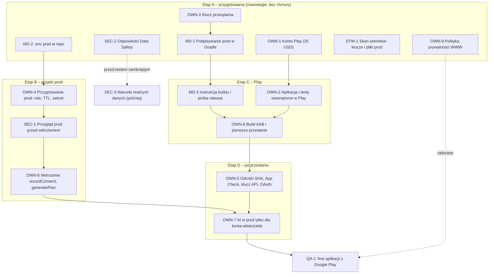

# Plan pierwszego wydania: Google Play – testy wewnętrzne (TAM-116)

- Data: 2026-11-26 · Autor (rola): architect · Zadanie: TAM-116 (REL-INT-PLAN)
- Dla: właściciela (wykonuje kroki w konsolach), orkiestratora (zakłada zadania), Stewarda, security, mobile-dev, qa
- Decyzja, na której plan stoi (właściciel, 2026-11-26): pierwsze wydanie produkcyjne trafia do **Google Play:
  testy wewnętrzne**, widoczne tylko dla testerów z listy (na start sam właściciel), **bez publikacji w sklepie**.
  App Check w prod działa z **Play Integrity** i **nie jest poluzowany** (żadnych tokenów debug w prod).
- Decyzja architektoniczna z tego planu: **ADR-0019** (budowanie i podpisywanie wydań Androida).
- Podstawa: `docs/architecture/deploy-dev-functions.md` (TAM-84, TAM-103), ADR-0001, 0002, 0003, 0011, 0014, 0016,
  0017, 0018, `docs/security/review-SEC-17-iam.md`, `docs/data/schema/firestore-ttl-indexes.md` pkt 6, runbook
  `.farm/runbooks/P3-03-firebase.md`, `docs/security/privacy-checklist.md`, `docs/security/personal-data-register.md`
  (v0.9, TAM-109), kod `backend/functions/src/` i `android/app/build.gradle.kts` (stan `main` c39ed62).
- **Niczego nie zmieniano w chmurze ani w kodzie.** Stan projektu prod opisano wyłącznie z dokumentów; każdy punkt
  „według przekazania” właściciel potwierdza odczytem przed wdrożeniem (sekcja 3).

## 1. W skrócie

**Co.** Ta sama aplikacja, która działa w `dev`, ma się zainstalować na telefonie właściciela **ze Sklepu Play**
(ścieżka „Testy wewnętrzne”) i łączyć się z projektem produkcyjnym `tamitu-prod-tadecode`.

**Po co.** Sprawdzić całą ścieżkę tak, jak zobaczy ją przyszły użytkownik: podpis Google, App Check z Play
Integrity bez tokenów debug, funkcje i model AI w prod, budżety prod. Nikt spoza listy testerów aplikacji nie zobaczy.

**Jak w pięciu etapach** (szczegóły i zależności – sekcja 10):

| Etap | Co się dzieje | Kto |
|---|---|---|
| A | Przygotowania bez kosztów i bez chmury: klucz przesyłania, podpisywanie w Gradle, plik `.env` prod, odpowiedzi do Data Safety, polityka prywatności | właściciel, mobile-dev, security, Steward |
| B | Projekt prod: role, TTL, sekret, konto budujące; przegląd security; wdrożenie `recordConsent` i `generatePlan`; AI tylko dla konta właściciela | właściciel, security |
| C | Play Console: aplikacja, testy wewnętrzne, lista testerów; pierwszy plik AAB | właściciel |
| D | Po pierwszym przesłaniu: odciski klucza podpisu Google → Firebase prod, App Check (Play Integrity), klucz API | właściciel |
| E | Test na telefonie z aplikacją zainstalowaną z Play | qa (z właścicielem) |

**Ile to kosztuje** (sekcja 9): jedyny pewny wydatek to **jednorazowa opłata za konto Play Console – 25 USD
(ok. 100 PLN)**, jeśli firma jeszcze jej nie zapłaciła. Reszta w praktyce **0 zł**: AI w prod ok. 1 grosz za plan
(najwyżej 5 planów na dobę konta właściciela, czyli do ok. 1,50 PLN/mies.), usługi Firebase/GCP w darmowych pulach,
a do ok. 2027-02-15 i tak z kredytu próbnego.

**Kroki właściciela: 9 zadań** (OWN-1…OWN-9, sekcja 10.2) plus odpowiedzi na pytania O-TAM116-1…6.

**Czego ten plan nie obejmuje:** publikacji w sklepie (testy zamknięte, otwarte, produkcja), realnych danych
użytkowników (`ALLOW_REAL_DATA=true`), funkcji `deleteAccount` i `budgetGuard`, wdrożeń prod z CI.

## 2. Założenia

1. **Tester = właściciel**, jedno konto Google. Lista testerów w Play Console może mieć do 100 adresów, ale
   każdy kolejny tester to osobna decyzja (dane osobowe D13, `testUids`, `ALLOW_REAL_DATA` – sekcja 4.7).
2. **Realne dane: nie w tym wydaniu** (propozycja; pytanie O-TAM116-1). `ALLOW_REAL_DATA=false` w prod, więc
   `generatePlan` przyjmuje tylko konta z `config/runtime.testUids` i żądania z `testData=true`
   (`config.ts`, `assertDataPolicy`; ADR-0011 pkt 6). Powody: SEC-15 otwarte, B-2 bez decyzji, polityka prywatności
   i zgoda AI w wersji `-v1` zakładają dane testowe (`app_constants.dart`: `ai-consent-v2` dopiero po SEC-15).
   Skutek dla buildu: AAB testów wewnętrznych budujemy z `--dart-define=TAMITU_TEST_DATA=true` (ADR-0011 pkt 6:
   „w `prod` `true` tylko w wewnętrznych buildach testowych”).
3. **Tylko dwie funkcje**: `recordConsent` i `generatePlan` (uzasadnienie – sekcja 4.6).
4. **Operacje w prod wykonuje wyłącznie właściciel** ze swojego komputera (SEC-17 W-3 c, ADR-0003: agenci nie mają
   poświadczeń prod). Agenci przygotowują polecenia; po sesji `gcloud auth revoke` i `firebase logout`.
5. **Repozytorium jest źródłem prawdy**: w repo nie ma `google-services.json`, klucza przesyłania, haseł ani UID
   (runbook P3-03 etap 10; `.gitignore`; hooki farmy blokują agentom dostęp do kluczy podpisu).

## 3. Stan wyjściowy projektu prod (z dokumentów – do potwierdzenia odczytem)

| Element | Stan wg dokumentów | Źródło | Sprawdzenie przed etapem B (tylko odczyt) |
|---|---|---|---|
| Projekt, region | `tamitu-prod-tadecode`, `europe-west4`, Blaze (konto próbne do ok. 2027-02-15) | runbook etap 1–2 | – |
| Budżet | 100 PLN/mies., progi 50/90/100% + prognoza 100%, temat `budget-alerts`, kredyty nieodliczane | runbook etap 3 | konsola Billing → Budżety |
| Spend cap Vertex AI | **80 PLN/mies.** – zatwierdzone (ADR-0014); wykonanie w prod **według przekazania orkiestratora, w repo brak zapisu** | ADR-0014, `sec-09-spend-cap-kroki.md` krok 6 | konsola Billing (spend cap), odnotować „Preview: tak/nie” |
| Buforowanie Vertex (B-1) | `disableCache=true` – **według przekazania**; w repo O5 i runbook etap 9 nadal „do wykonania” | SEC-17 B-1, O5 | `GET cacheConfig` z SEC-17 sekcja 4.1 (sam `GET`) → `disableCache = True` |
| Logi | kubełek `tamitu-logs` (UE, 30 dni), sink, `_Default` wyłączony | runbook etap 4 | – (test odbioru po wdrożeniu, sekcja 4.9) |
| Konta funkcji | `fn-ai-plan`, `fn-consent`, `fn-account`, `fn-budget` z **szerokimi** rolami predefiniowanymi | runbook etap 5, SEC-17 sekcja 3 | `gcloud projects get-iam-policy` (SEC-17 4.4) |
| Sekret `UID_HASH_PEPPER` | utworzony **bez wersji** (wartość dodaje właściciel) | runbook etap 5 | `gcloud secrets versions list UID_HASH_PEPPER --project=tamitu-prod-tadecode` |
| Konto budujące (Compute) | brak wpisu dla prod (w dev dodano `cloudbuild.builds.builder`, B1 z TAM-84) | `deploy-dev-functions.md` 4.1 | `get-iam-policy` |
| Auth | tylko Google, aplikacja Android `pl.tadecode.tamitu` **bez SHA** | runbook etap 6 | – |
| App Check | API włączone; Play Integrity w prod **niezarejestrowane**; tokenów debug brak (zakaz) | runbook etap 7, SEC-17 N-4 | konsola App Check: lista tokenów debug pusta |
| Firestore | `(default)`, `europe-west4`, ochrona przed usunięciem, reguły `deny all`; **bez TTL i indeksów** (O4) | runbook etap 8 | `gcloud firestore fields ttls list` |
| `config/runtime` | `aiEnabled=false`, `allowRealData=false`, `testUids=[]`, `perUserDailyLimit=5`, `globalDailyLimit=50` (zmiana na 25 zlecona w SEC-09-CAP, wykonanie niepotwierdzone w repo) | runbook etap 8, ADR-0014 Aneks A pkt 3 | konsola Firestore |
| Klucz API Android prod | bez ograniczenia aplikacji (czeka na SHA klucza wydań) | runbook etap 10, SEC-17 Ś-4 | – |
| Funkcje | żadna nie jest wdrożona w prod | runbook, `deploy-dev-functions.md` sekcja 9 | `gcloud run services list` → pusto |

Jeśli którykolwiek odczyt różni się od tabeli – zatrzymać się i zgłosić (orkiestrator → architect/security).

## 4. Produkcja Firebase/GCP

Wszystkie polecenia: **tylko** `tamitu-prod-tadecode`, wykonuje właściciel. Wzorzec poleceń jest ten sam co w dev
(`deploy-dev-functions.md` 5.1–5.3) – poniżej tylko różnice i kolejność. Na początku każdej sesji:
`$p = 'tamitu-prod-tadecode'`, `gcloud auth login`, `firebase login --reauth`, katalog na aktualnym `main`.

### 4.1 Warunki wstępne (przed pierwszym wdrożeniem funkcji)

| # | Co | Jak | Dlaczego |
|---|---|---|---|
| P1 | Spend cap 80 PLN i budżet 100 PLN aktywne | odczyt w konsoli (sekcja 3) | ADR-0014: w dev warunek włączenia Cloud Functions API; w prod tym bardziej |
| P2 | `disableCache=true` (B-1) | sam `GET` (SEC-17 4.1, `$p` = prod); gdy `False` → `PATCH` z tej sekcji | bez tego Vertex zapisuje dane wejściowe do 24 h (rejestr D6) |
| P3 | Wersja sekretu `UID_HASH_PEPPER` | `versions list`; gdy brak – dodać losową wartość **inną niż w dev** poleceniem z runbooka, etap 5 | bez wersji Firebase CLI zatrzyma wdrożenie |
| P4 | Konto budujące z `roles/cloudbuild.builds.builder` (B1 z TAM-84) | `deploy-dev-functions.md` 5.1 krok 2 z `$p` prod | bez tego funkcja się nie zbuduje; nie nadawać `roles/editor` (SEC-17 W-5) |
| P5 | Role niestandardowe i ich przypisanie (sekcja 4.3) | SEC-17 sekcja 4.2 z `$p` prod | najmniejsze uprawnienia przed pierwszym kodem w prod |
| P6 | TTL i indeksy (O4-2 prod, sekcja 4.2) | `firestore-ttl-indexes.md` pkt 6 | od pierwszego planu funkcja zapisuje licznik `usage` (D10) |
| P7 | Plik `backend/functions/.env.tamitu-prod-tadecode` w `main` (sekcja 4.5) | `Get-Content` | bez niego funkcja nie zna modelu AI (`ai_unavailable`) |
| P8 | Przegląd security (SEC-1, sekcja 10.2) z wynikami P1–P6 | raport w PR lub wpis w dzienniku | bramka przed wdrożeniem kodu w prod |

### 4.2 TTL i indeksy (O4-2 w prod)

Dokładnie wg `docs/data/schema/firestore-ttl-indexes.md` pkt 6 z `<P>` = `tamitu-prod-tadecode`:
`firebase deploy --only firestore:indexes --project=tamitu-prod-tadecode`, potem odczyt `ttls list` i
`indexes composite list`. Oczekiwane: TTL `ACTIVE` na `usage.expireAt` i `usage_global.expireAt`, **brak** TTL na
`usage.updatedAt`, indeks `consents (type ASC, receivedAt DESC)` `READY`. Stan `CREATING` może trwać godziny –
wdrożenie funkcji może iść równolegle (polityka TTL na pustej kolekcji niczego nie usuwa). Reguł (`firestore:rules`)
nie wdrażamy ponownie, jeśli `backend/firestore.rules` nie zmienił się od etapu 8 runbooka (`deny all`).

### 4.3 Wąskie role (SEC-17 W-1, W-2, Ś-1, Ś-2)

Propozycja: **wszystkie cztery poprawki w prod od razu**, przed pierwszym wdrożeniem, a nie dopiero „przed realnymi
danymi”. Uzasadnienie: polecenia są gotowe (SEC-17 4.2), w dev działają już `tamitu.vertexInvoker`,
`tamitu.authUserReader`, `tamitu.fsUsageWriter` dla `fn-ai-plan` (TAM-90), a prod to pierwsze miejsce, gdzie kod
działa z dostępem do prawdziwego projektu. Odwrotna kolejność (najpierw szerokie role, potem zawężanie) wymagałaby
drugiej sesji Ownera w prod.

| Konto | Docelowo (SEC-17 sekcja 3) | Stan w dev | Uwaga dla prod |
|---|---|---|---|
| `fn-ai-plan` | `tamitu.vertexInvoker`, `tamitu.fsUsageWriter`, `tamitu.authUserReader`, sekret | zrobione i sprawdzone (TAM-90) | przenieść 1:1 |
| `fn-consent` | `tamitu.fsConsentWriter`, `tamitu.authUserReader`, sekret | **niesprawdzone w dev** (w repo brak zapisu) | **najpierw dev + test zgody na telefonie (qa)**, potem prod; błąd `PERMISSION_DENIED` → dopisać uprawnienie do roli, nie wracać do `datastore.user` |
| `fn-account` | `datastore.user`, `tamitu.authUserDeleter`, sekret (W-2) | niesprawdzone | funkcja nie jest wdrażana; zmiana roli jest bezpieczna i zamyka W-2 zawczasu |
| `fn-budget` | `tamitu.fsConfigUpdater` | niesprawdzone | funkcja nie jest wdrażana; zawęzić od razu |

Kontrola: `gcloud projects get-iam-policy` (SEC-17 4.4) – konta `fn-*` wyłącznie z tabeli, konto Compute bez
`roles/editor`, tylko właściciel z `roles/owner`. Wynik (bez e-maili) – do runbooka P3-03, etap 5.

### 4.4 B-1 i B-2

- **B-1** (buforowanie Vertex): warunek P2. Zamyka O5 po potwierdzeniu `GET` w obu projektach (runbook etap 9).
- **B-2** (monitoring nadużyć Google, prompty do 90 dni): **bloker tylko dla `ALLOW_REAL_DATA=true`**. W tym wydaniu
  dane są testowe (założenie 2), więc B-2 nie blokuje. Przed włączeniem realnych danych: decyzja właściciela
  o rodzaju umowy z Google i ryzyku (SEC-15 poz. 4), opis w polityce [PRAWNIK] – zadanie SEC-3.

### 4.5 Plik `backend/functions/.env.tamitu-prod-tadecode`

W repo, jak plik dev (decyzja O-TAM84-1 „W repo” obejmuje też prod; wartości nie są sekretami). Wyjątek
`!backend/functions/.env.tamitu-prod-tadecode` w `.gitignore`. Treść (mobile-dev, MD-2):

```
ENVIRONMENT=prod
ENFORCE_APP_CHECK=true
ALLOW_REAL_DATA=false
AI_MODEL_ID=gemini-3.1-flash-lite
AI_LOCATION=eu
```

- W prod wpisujemy `ENFORCE_APP_CHECK` i `ALLOW_REAL_DATA` **jawnie** (w dev działają z wartości domyślnych): przy
  kontroli po wdrożeniu (4.9 a) widać je wtedy wprost w `environmentVariables`. Wartości są i tak „fail-closed”
  (`config.ts`): brak `ENVIRONMENT` = prod, brak `ENFORCE_APP_CHECK` = `true`, brak `ALLOW_REAL_DATA` = `false`.
- **Nigdy** w prod: `ENFORCE_APP_CHECK=false`, `AI_ENDPOINT_OVERRIDE`, `AI_ATTEMPT_TIMEOUT_MS` (atrapa z TAM-89/TAM-115
  – funkcja i tak odrzuca je poza emulatorem: `ai_endpoint_override_rejected`), `AI_PROMPT_VERSION` (domyślne `plan-v1`).
- Model i punkt jak w dev (ADR-0001 Aneks C): `gemini-3.1-flash-lite`, `eu` – nigdy `global`.
- `ALLOW_REAL_DATA=true` w tym pliku zmienia się **osobnym PR-em** po zamknięciu SEC-15 i SEC-3 (sekcja 11, O-TAM116-1).

### 4.6 Które funkcje wdrażamy

| Funkcja | Prod teraz? | Uzasadnienie |
|---|---|---|
| `recordConsent` | **TAK** | bez zapisu zgody aplikacja nie przejdzie EK-02/EK-03 |
| `generatePlan` | **TAK** | sedno testu; koszt ograniczony (sekcja 9) |
| `deleteAccount` | **NIE** | kod zwraca `not_implemented` (P3-08); wdrożenie nic nie daje, a wystawia publiczny punkt z kontem, które może usuwać użytkowników. W aplikacji „Usuń konto” w tym wydaniu kończy się błędem – znane ograniczenie (qa nie zgłasza jako błąd). **Warunek przed testami zamkniętymi/otwartymi**: Google Play wymaga usuwania konta w aplikacji i strony WWW z instrukcją (privacy-checklist pkt 5) |
| `budgetGuard` | **NIE** | `budgetGuardCore` jeszcze nie wyłącza AI (TODO P3-09), więc wdrożenie nie dałoby ochrony, a wymaga Eventarc i `run.invoker` dla `fn-budget` (SEC-17 N-5). Ochronę w tym wydaniu dają: spend cap 80 PLN, budżet 100 PLN z alertami, `testUids` (tylko konto właściciela woła model), limit 5/dobę na konto i 25/dobę globalnie, `maxInstances: 10`. Odstępstwo od ADR-0003 („`budgetGuard` w prod”) jest **czasowe** – warunek przed realnymi danymi (P3-09) |

Zawsze `firebase deploy --only functions:recordConsent` i osobno `--only functions:generatePlan`. **Nigdy** samo
`firebase deploy` ani `--only functions` (poszłyby `deleteAccount` i `budgetGuard`).

### 4.7 `config/runtime` w prod

Zmienia tylko właściciel w konsoli Firebase (2FA, ADR-0002 Aneks A pkt 7), procedura jak w dev
(`deploy-dev-functions.md` 5.3), projekt prod:

| Pole | Wartość na test | Uwaga |
|---|---|---|
| `aiEnabled` | `true` (boolean) dopiero przed testem qa; poza testami `false` | wyłącznik kosztów bez wdrażania |
| `allowRealData` | `false` | realne dane wymagają **obu** flag: `.env` i `config/runtime` (`assertDataPolicy`) |
| `testUids` | UID konta właściciela **w prod** (inny niż w dev – nowy projekt Auth, UID powstaje przy pierwszym logowaniu z aplikacji z Play) | dana osobowa: nigdy w repo, Jirze, logu, czacie; w raportach „`testUids` ma N wpisów” |
| `perUserDailyLimit` | `5` | bez zmian |
| `globalDailyLimit` | **`25`** (sprawdzić; runbook ma 50) | ADR-0014 Aneks A pkt 3 |
| `policyVersionCurrent` | `privacy-v1` | = `AppConstants.privacyPolicyVersion` |
| `aiConsentVersionCurrent` | `ai-consent-v1` | = `AppConstants.aiConsentVersion` |

Kolejność: pierwsze logowanie z aplikacji (zgoda na politykę działa bez `testUids`) → odczyt UID w Authentication →
dopisanie do `testUids` → `aiEnabled=true` → pierwszy plan. Przed tym `generatePlan` odpowiada `test_data_only`
(bez kosztu) – to oczekiwane.

### 4.8 Kroki wdrożenia (skrót; pełne polecenia – `deploy-dev-functions.md` 5.1 i 5.2 z `$p` prod)

1. Krok 0 (logowanie, `git pull` na `main`), warunki P1–P8.
2. Kontrola przed wdrożeniem: `npm ci; npm run lint; npm run typecheck; npm test` w `backend\functions`;
   `gcloud run services list` → pusto.
3. `firebase deploy --only functions:recordConsent --project tamitu-prod-tadecode` → kontrola 4.9.
4. `firebase deploy --only functions:generatePlan --project tamitu-prod-tadecode` → kontrola 4.9.
   Przy pytaniu o cleanup policy obrazów – **1 dzień**; przy pytaniu o włączenie dodatkowego API – **przerwać**
   i zgłosić (w dev nie było takiej potrzeby).
5. `gcloud auth revoke`, `firebase logout` (W-3). Wpis do runbooka P3-03 (bez e-maili, numerów kont, UID).

### 4.9 Kontrole po wdrożeniu

Te same co w dev (`deploy-dev-functions.md` 5.1 krok 6–7 i 5.2 krok 4, 7), z oczekiwaniami prod:
- a) `ACTIVE`, właściwe konto (`fn-consent@` / `fn-ai-plan@`), `maxInstanceCount: 10`, zmienne:
  `ENVIRONMENT: prod`, `ENFORCE_APP_CHECK: 'true'`, `ALLOW_REAL_DATA: 'false'`, `AI_MODEL_ID`, `AI_LOCATION: eu`;
- b) usługi Cloud Run tylko `recordconsent` i `generateplan`;
- c) `run.invoker` tylko `allUsers` (wymóg callable, N-5);
- d) pełna polityka IAM projektu i sekretu = sekcja 4.3 (nic nie doszło);
- e) wywołanie bez logowania → 401 `unauthenticated`;
- f) logi `fn_event`/`fn_error` po teście qa: tylko pola z `logger.ts`, `uidHash` zamiast UID, bez treści planu;
  wpisy trafiają do kubełka `tamitu-logs` (test odbioru ADR-0003 Aneks A pkt 1, runbook „Czego nie zrobiono” #1);
- g) App Check: lista tokenów debug w prod **pusta** (N-4) – przy każdej bramce wydania.

### 4.10 Cofanie

Jak w `deploy-dev-functions.md` sekcja 6 (usługi `recordconsent`, `generateplan`, `$p` prod). Najszybsza blokada
kosztu: `config/runtime.aiEnabled=false`; najszybsza blokada ruchu: zdjęcie `allUsers` z `generateplan` (HTTP 403).
Uwaga: w prod Firestore ma ochronę przed usunięciem, a dane zgód z prod nie są „testowe” w sensie retencji –
nie usuwać ich ręcznie.

## 5. App Check w prod (Play Integrity)

**Zasada:** prod przyjmuje wyłącznie tokeny Play Integrity. Aplikacja w flavorze `prod` zawsze używa
`AndroidPlayIntegrityProvider` (`environment.dart`: `appCheckModeFor`), a funkcje egzekwują App Check w kodzie
(`ENFORCE_APP_CHECK=true`). Tokenów debug w prod nie tworzymy (ADR-0003 Aneks A pkt 2, SEC-16).

Kroki (właściciel, OWN-2 i OWN-5):
1. **Play Console → Test and release → App integrity → Play Integrity API → połącz projekt Cloud**
   `tamitu-prod-tadecode` (runbook etap 7). Bez tego Play Integrity nie zwraca werdyktów dla Firebase.
2. **Play App Signing** jest obowiązkowe dla nowych aplikacji (AAB). Klucz podpisu aplikacji (app signing key)
   generuje i trzyma Google; my mamy tylko klucz przesyłania (upload key, ADR-0019).
3. Po **pierwszym przesłaniu AAB** (OWN-8): Play Console → App integrity → App signing → skopiować **SHA-1 i SHA-256
   klucza podpisu aplikacji** oraz **SHA-1 i SHA-256 klucza przesyłania**.
4. Firebase prod → Ustawienia projektu → aplikacja `pl.tadecode.tamitu` → **dodać odciski** (oba klucze):
   - SHA-1 klucza podpisu Google – potrzebne do **logowania Google** z aplikacji z Play (bez niego błąd
     `DEVELOPER_ERROR`/kod 10);
   - SHA-1 klucza przesyłania – logowanie z buildu release zainstalowanego lokalnie (próba przed wysłaniem, MD-3);
   - SHA-256 klucza podpisu Google – do **App Check**.
5. Firebase prod → **App Check → Apps → `pl.tadecode.tamitu` → Play Integrity** → SHA-256 klucza **podpisu
   aplikacji (Google)** → Save → stan „Registered”. Ustawienia dostawcy (N-3): wymagać „Play recognized”
   i integralności urządzenia (`MEETS_DEVICE_INTEGRITY`). Czas życia tokenu – domyślny (1 h).
6. **Egzekwowanie dla Firestore** w konsoli App Check (SEC-17 N-3): włączyć. Klient nie używa Firestore, więc nic się
   nie zepsuje; to obrona na wypadek pomyłki w regułach. Egzekwowania w konsoli dla Functions **nie włączamy** –
   egzekwuje kod (ADR-0002).
7. **Klucz API Android prod** (SEC-17 Ś-4): ograniczenie aplikacji = pakiet `pl.tadecode.tamitu` + SHA-1 obu kluczy;
   lista API zawężona jak w dev (N-1). Klucz Browser w prod – bez zmian w tym wydaniu (propozycja usunięcia po
   tygodniu bez błędów, Ś-4).
8. Po zmianie odcisków pobrać ponownie `google-services.json` prod (runbook etap 10) do
   `%USERPROFILE%\.tamitu\firebase\prod\` – do następnego buildu. Pierwszego AAB **nie trzeba** przebudowywać:
   sprawdzenie pakietu i odcisku robi serwer Google.

**Dowód egzekwowania (qa, QA-1):** ten sam kod zainstalowany lokalnie (APK release `prod` podpisany kluczem
przesyłania, nie z Play) musi dostać od funkcji `app_check_failed`, a wersja z Play – przejść. Lokalny build nie
jest „Play recognized”, więc to naturalny test negatywny bez żadnych tokenów debug.

## 6. Aplikacja: build release (AAB)

Decyzje w ADR-0019; tu wymagania dla mobile-dev (MD-1, MD-3) i właściciela (OWN-3, OWN-8).

| Temat | Wymaganie |
|---|---|
| Format | **AAB** (`flutter build appbundle --release --flavor prod`); Play nie przyjmuje APK dla nowych aplikacji |
| Flavor | `prod` (jest w `build.gradle.kts`: pakiet `pl.tadecode.tamitu`, nazwa „Tamitu”). Pakietu po pierwszym przesłaniu **nie da się zmienić** |
| Podpisywanie | `release` dziś podpisuje **kluczem debug** (`TODO` w `build.gradle.kts`). MD-1: dla `prodRelease` konfiguracja podpisu czyta klucz przesyłania **spoza repo** (ścieżka i hasła z właściwości Gradle w `%USERPROFILE%\.gradle\gradle.properties` albo ze zmiennych środowiskowych); **brak klucza = błąd buildu** (bez cichego powrotu do klucza debug – wzorem SEC-33/SEC-35 dla `google-services.json`). `devRelease` może zostać na kluczu debug |
| Klucz przesyłania | generuje właściciel (`keytool`, RSA 4096, ważność ≥ 25 lat), plik w `%USERPROFILE%\.tamitu\signing\` poza repo; hasła i kopia pliku w menedżerze haseł firmy (OWN-3). Agenci nie mają do niego dostępu (hooki farmy) |
| `google-services.json` prod | z `%USERPROFILE%\.tamitu\firebase\prod\` kopiowany do `android/app/src/prod/` (w `.gitignore`); brak pliku = błąd buildu release (już jest) |
| Stałe kompilacji | `--dart-define=TAMITU_TEST_DATA=true` (założenie 2). **Bez** `TAMITU_APP_CHECK_DEBUG_TOKEN`, `TAMITU_FAKE_BACKEND`, `TAMITU_USE_FIREBASE_EMULATORS` (kod i tak odrzuca je w `prod`/release) |
| Wersjonowanie | `version:` w `pubspec.yaml` = `versionName+versionCode`. Pierwsze wydanie: **`0.1.0+1`** (obecna wartość). Każde przesłanie do Play (dowolna ścieżka) wymaga **większego `versionCode`**; podbicie robi mobile-dev w PR-ze przed buildem (ślad w git). `versionName` wg SemVer; `0.x` do wydania publicznego. Po przesłaniu – tag `v0.1.0+1` na commicie buildu (właściciel albo Steward) |
| R8 / ProGuard | Flutter w release domyślnie włącza zmniejszanie kodu R8. Wtyczki (Firebase, SQLCipher, `flutter_secure_storage`, logowanie Google) mają własne reguły. **Ryzyko:** awaria tylko w release → MD-3: próba release na telefonie przed przesłaniem. Plik `mapping.txt` (`build/app/outputs/mapping/prodRelease/`) przesłać w Play Console do wydania (czytelne raporty awarii w Android vitals); trzymać poza repo |
| Obfuskacja Dart | **nie** w tym wydaniu (`--obfuscate` utrudnia diagnozę; aplikacja nie ma sekretów w kodzie) |
| Rozmiar | po zbudowaniu odczyt rozmiaru w Play Console (App bundle explorer). Orientacyjnie Flutter + SQLCipher: kilkanaście–kilkadziesiąt MB pobrania na urządzenie; próg do zgłoszenia: > 50 MB pobrania |
| `targetSdk` | `flutter.targetSdkVersion` z przypiętej wersji Fluttera (GH-013). Play wymaga aktualnego poziomu API dla nowych aplikacji – MD-3 sprawdza przed przesłaniem; konsola odrzuci plik z za niskim poziomem |
| Ikona | adaptacyjna ikona Tamitu jest w `android/app/src/main/res/mipmap-anydpi-v26` (UX `icon-and-illustration.md`) – do testów wewnętrznych wystarcza |

## 7. Google Play Console (kroki właściciela)

### 7.1 Konto (OWN-1, poza farmą)

- Konto **organizacji** TadeCode (wymaga numeru D-U-N-S; weryfikacja tożsamości i kontaktu trwa zwykle kilka dni).
  Konto organizacji nie podlega wymogowi „12 testerów przez 14 dni w teście zamkniętym”, który dotyczy nowych kont
  osobistych przed produkcją – to nie blokuje testów wewnętrznych, ale ułatwi późniejsze wydanie.
- **Jednorazowa opłata rejestracyjna: 25 USD** [PŁATNE] – pytanie O-TAM116-4 (czy już zapłacona).
- 2FA na koncie Google właściciela (jest – runbook etap 0). Dostęp do Play Console: tylko właściciel.

### 7.2 Aplikacja i testy wewnętrzne (OWN-2, OWN-8)

1. **Utwórz aplikację**: nazwa „Tamitu”, język domyślny polski (pl-PL), aplikacja (nie gra), **bezpłatna**
   (uwaga: aplikacji bezpłatnej nie można później zmienić na płatną; zakupy w aplikacji – np. „słoneczka” – są
   nadal możliwe), oświadczenia o zasadach programu i przepisach eksportowych.
2. **Play App Signing**: zostawić domyślne „Google generuje i chroni klucz podpisu aplikacji”.
3. **Testy wewnętrzne → Testerzy**: utworzyć listę e-mail (np. „Tamitu – zespół”) z adresem konta Google właściciela.
   Lista to dane osobowe (rejestr D13): tylko w Play Console, nigdy w repo.
4. **Testy wewnętrzne → Utwórz wersję**: przesłać AAB (OWN-8), plik `mapping.txt`, krótkie notatki do wersji
   (PL), zapisać i **wdrożyć na testy wewnętrzne**. Testy wewnętrzne nie przechodzą przeglądu Google; wersja jest
   dostępna dla testerów zwykle w kilka minut.
5. **Link do udziału** (opt-in): właściciel otwiera go na telefonie zalogowanym tym samym kontem Google, akceptuje,
   instaluje „Tamitu” ze Sklepu Play. Wersja `dev` („Tamitu Dev”, inny pakiet) może zostać zainstalowana obok.
6. **App integrity → Play Integrity API → połącz projekt Cloud** `tamitu-prod-tadecode` (sekcja 5, krok 1).
7. Po pierwszym przesłaniu: odciski kluczy → Firebase (sekcja 5, kroki 3–8, OWN-5).

### 7.3 Minimalne wymagania i czego **nie** trzeba do testów wewnętrznych

Według pomocy Google testy wewnętrzne można uruchomić **przed** ukończeniem karty sklepu i deklaracji „Zawartość
aplikacji”. Konsola sama wskaże, czego brakuje – jeśli zażąda czegoś więcej, uzupełnić według kolumny „Treść”.

| Pozycja | Do testów wewnętrznych | Do testów zamkniętych / otwartych / produkcji | Treść (gdy wypełniamy) |
|---|---|---|---|
| Polityka prywatności (URL) | zalecane (aplikacja i tak linkuje do niej w EK-02) | **wymagane** | `https://tadecode.pl/tamitu/prywatnosc` (PL), `/en` (EN) – O-TAM116-2 |
| Data Safety | niewymagane | **wymagane** | odpowiedzi przygotowuje security (SEC-2): **bez lokalizacji** (TAM-109, ADR-0017); m.in. adres e-mail i identyfikator konta (logowanie Google, Firebase Auth), dane wpisywane przez użytkownika wysyłane do AI (cel, daty, nocleg, preferencje – „przetwarzane tymczasowo”), identyfikatory urządzenia/aplikacji (App Check, Firebase Installations), szyfrowanie w transmisji: tak, usuwanie danych: przez usunięcie konta w aplikacji (**dopiero po P3-08**) i e-mailem |
| Usuwanie konta: w aplikacji + strona WWW z instrukcją | niewymagane | **wymagane** (aplikacja z kontami) | P3-08 + W-2; strona `tadecode.pl/tamitu/...` (privacy-checklist pkt 5) |
| Ikona 512×512, grafika 1024×500, zrzuty ekranu, opisy | niewymagane | wymagane (karta sklepu) | UX (zasoby z `icon-and-illustration.md`) |
| Kategoria | niewymagana | wymagana | **Podróże i informacje lokalne** |
| Ocena treści (kwestionariusz IARC) | niewymagana | wymagana | bez przemocy, bez treści użytkowników widocznych dla innych, bez zakupów – bezpłatna |
| Grupa docelowa | niewymagana | wymagana | **18+** (N8, tylko dorośli) |
| Reklamy | niewymagane | wymagane | „**Nie zawiera reklam**” (reklamy poza MVP, privacy-checklist pkt 2) |
| Dostęp do aplikacji (dla przeglądu Google) | niewymagany | wymagany | logowanie Google; konto testowe dla recenzentów – decyzja przed testem zamkniętym |
| Identyfikator wyświetlania reklam (Advertising ID) | niewymagany | wymagany | „nie używa” (sprawdzić, że zależności nie dodają uprawnienia `AD_ID`) |
| Przegląd aplikacji przez Google | **nie ma** | jest (do kilku dni) | – |

Rekomendacja: Data Safety, kategorię, ocenę treści, grupę docelową i reklamy wypełnić już teraz (bez kosztu,
~30 min), bo i tak będą potrzebne; **nie** wysyłać aplikacji do przeglądu ani na inne ścieżki.

### 7.4 Ekran zgody OAuth w prod (OWN-5)

Logowanie Google korzysta z ekranu zgody OAuth projektu `tamitu-prod-tadecode` (Google Auth Platform → Branding /
Audience). Sprawdzić: nazwa „Tamitu”, e-mail pomocy (rozważyć adres grupy, runbook etap 6), link do polityki
prywatności, typ użytkowników „Zewnętrzni”. Przy statusie „Testowanie” logować się mogą tylko dodani użytkownicy
testowi – dopisać konto właściciela albo przełączyć na „W produkcji” (zakresy podstawowe `email`, `profile`,
`openid` nie wymagają weryfikacji). **Nie dodawać logo** na ekranie zgody – logo uruchamia weryfikację marki przez
Google (dni–tygodnie). Dev działa, więc ustawienia dev są wzorcem.

## 8. CI/CD i kto co robi (ADR-0019)

| Czynność | Teraz (wydanie 0.1.0) | Później (etap 2 ADR-0019, osobne zadanie Stewarda) |
|---|---|---|
| Testy, analiza, build debug `dev` | CI (bez zmian) | bez zmian |
| Build AAB `prod` release | **lokalnie, właściciel** (klucz przesyłania nie opuszcza jego komputera i menedżera haseł) | CI: zadanie ręczne (`workflow_dispatch`) w środowisku GitHub `release` z wymaganym zatwierdzeniem właściciela; sekrety klucza przesyłania i `GOOGLE_SERVICES_JSON_PROD` ustawia Steward |
| Przesłanie do Play | **ręcznie w Play Console** (pierwszy plik i tak musi być przesłany ręcznie) | nadal ręcznie; automat (Play Developer API) – poza MVP |
| Wdrożenie funkcji prod | **ręcznie, właściciel** (W-3 c) | CI dopiero po W-4 i Ś-3 (GH-010 dla prod) – poza tym planem |
| Sekrety | brak nowych sekretów w CI | Steward: `UPLOAD_KEYSTORE_BASE64`, `UPLOAD_KEYSTORE_PASSWORD`, `UPLOAD_KEY_ALIAS`, `UPLOAD_KEY_PASSWORD`, `GOOGLE_SERVICES_JSON_PROD` – tylko w środowisku `release` |
| Zabezpieczenie repo | Steward (STW-1): skan sekretów (gitleaks) i `.gitignore` obejmują pliki kluczy (`*.jks`, `*.keystore`, `*.p12`, `key.properties`) i `google-services.json` | bez zmian |

Kto co robi – podsumowanie: **właściciel** – konsole (GCP, Firebase, Play), klucz przesyłania, build i przesłanie
AAB, wdrożenia prod; **Steward** – CI i sekrety (dziś tylko STW-1); **security** – przegląd prod, Data Safety,
warunki realnych danych; **mobile-dev** – podpisywanie, `.env` prod, instrukcja buildu i próba release;
**qa** – test aplikacji z Play; **orkiestrator** – zadania w Jirze, prośby do Stewarda, bramka G5 (gdy dojdziemy
do wydania publicznego).

## 9. Koszty – każdy krok płatny lub z ryzykiem kosztu osobno

| # | Krok | Rodzaj | Kwota | Kiedy | Ochrona / uwagi |
|---|---|---|---|---|---|
| K1 | Rejestracja konta Google Play Console | **[PŁATNE] jednorazowo** | **25 USD** (ok. 100 PLN wg kursu; kartą firmy) | OWN-1, jeśli jeszcze nie zapłacone (O-TAM116-4) | płaci właściciel poza farmą |
| K2 | D-U-N-S | bezpłatne (zwykła ścieżka) | 0 | OWN-1 | **nie** wybierać płatnych przyspieszeń oferowanych przez D&B |
| K3 | Vertex AI w prod (`generatePlan`) | **[RYZYKO KOSZTU] zmienne** | ok. 0,01 PLN za plan; przy 5 planach/dobę konta właściciela ≈ **do 1,50 PLN/mies.** | od OWN-7 (`aiEnabled=true`) | `testUids` (tylko właściciel), limit 5/dobę na konto i 25/dobę globalnie, spend cap **80 PLN**, budżet 100 PLN z alertami; `aiEnabled=false` poza testami. 429 nie są rozliczane (ADR-0016) |
| K4 | Cloud Build, Cloud Run, Artifact Registry, Secret Manager, Firestore, Logging w prod | **[RYZYKO KOSZTU] zmienne** | **0 zł** w darmowych pulach; najgorzej grosze (np. obrazy > 0,5 GB w Artifact Registry) | OWN-4, OWN-6 | darmowe pule są **wspólne dla dev i prod** (jedno konto rozliczeniowe) – przy obecnym ruchu z dużym zapasem; cleanup policy obrazów 1 dzień; `maxInstances: 10`. Spend cap nie obejmuje tych usług (ADR-0014) |
| K5 | Firebase Auth (logowanie Google), App Check, Play Integrity API, Play App Signing | bezpłatne | 0 | – | Play Integrity: darmowy limit 10 tys. żądań standardowych/dobę; Auth bez Identity Platform |
| K6 | Okres próbny GCP | **[RYZYKO KOSZTU] po dacie** | do ok. **2027-02-15** koszty K3–K4 pokrywa kredyt; potem płaci firma | przed 2027-02-16 (runbook „Czego nie zrobiono” #8) | decyzja „Przejdź na wersję płatną” – tylko właściciel; bez niej Google zatrzyma zasoby prod i dev |
| K7 | Strona z polityką prywatności na `tadecode.pl` | zależnie od obecnego hostingu | zakładamy 0 (istniejąca strona firmy) | OWN-9 | O-TAM116-2 |
| K8 | Build release w CI (etap 2 ADR-0019, później) | **[RYZYKO KOSZTU]** | minuty GitHub Actions (repo prywatne): ok. 10–15 min na build Linux; w planie Free 2 000 min/mies. wspólnie z resztą CI | dopiero przy STW-2 | Steward sprawdza zużycie minut przed włączeniem |

**Razem dla tego wydania: 25 USD jednorazowo (jeśli konto Play jeszcze nieopłacone) + ok. 0–2 PLN/mies. (z kredytu
próbnego).** Plan nie zwiększa żadnego limitu ani pułapu kosztu (zasada 10).

## 10. Kolejność, zależności i zadania

### 10.1 Graf zależności



Ścieżka krytyczna: **OWN-1 (D-U-N-S i weryfikacja konta – dni) → OWN-2 → OWN-8 → OWN-5 → OWN-7 → QA-1.**
Etap B nie zależy od Play i może iść równolegle.

### 10.2 Zadania do założenia w Jirze (tytuły prostym językiem)

| ID roboczy | Tytuł | Rola | Zależy od | Gotowe, gdy |
|---|---|---|---|---|
| OWN-1 | Załóż konto Google Play Console firmy (D-U-N-S, opłata 25 USD) | właściciel | – | konto organizacji zweryfikowane; status w O-TAM116-4 |
| OWN-2 | Utwórz aplikację Tamitu w Play Console i listę testerów wewnętrznych | właściciel | OWN-1 | aplikacja `pl.tadecode.tamitu`, Play App Signing domyślne, lista testerów, połączony projekt Cloud (Play Integrity) – sekcja 7.2 pkt 1–3, 6 |
| OWN-3 | Wygeneruj klucz przesyłania aplikacji i schowaj go poza repozytorium | właściciel | – | plik w `%USERPROFILE%\.tamitu\signing\`, hasła i kopia w menedżerze haseł (ADR-0019) |
| OWN-4 | Przygotuj projekt produkcyjny: role kont funkcji, TTL, sekret, konto budujące | właściciel | MD-2 (merge) | P1–P7 z sekcji 4.1 wykonane, wyniki odczytów (bez e-maili) w runbooku P3-03 |
| OWN-5 | Dodaj odciski klucza podpisu do Firebase prod i włącz App Check z Play Integrity | właściciel | OWN-8 | sekcja 5 kroki 3–8 i 7.4: odciski, App Check „Registered”, egzekwowanie Firestore, klucz API ograniczony, ekran zgody OAuth sprawdzony |
| OWN-6 | Wdróż w produkcji funkcje zgody i tworzenia planu | właściciel | SEC-1 | sekcja 4.8; kontrole 4.9 a–e zgodne |
| OWN-7 | Włącz tworzenie planów w produkcji tylko dla swojego konta | właściciel | OWN-5, OWN-6 | `config/runtime` wg 4.7 (`testUids` ma 1 wpis, `globalDailyLimit=25`, `aiEnabled=true` na czas testu) |
| OWN-8 | Zbuduj plik AAB i prześlij pierwsze wydanie na testy wewnętrzne | właściciel | MD-3, OWN-2, OWN-3 | wersja `0.1.0 (1)` wdrożona na testy wewnętrzne, `mapping.txt` przesłany, tag w git |
| OWN-9 | Opublikuj politykę prywatności pod adresem tadecode.pl/tamitu/prywatnosc | właściciel (treść: security, [PRAWNIK]) | O-TAM116-2 | strona PL i EN publicznie dostępna, wersja = `privacy-v1` |
| STW-1 | Sprawdź, że skan sekretów i .gitignore blokują klucze podpisu i pliki prod | Steward | – | gitleaks i `.gitignore` obejmują `*.jks`, `*.keystore`, `*.p12`, `key.properties`, `google-services.json`; próba na gałęzi testowej |
| STW-2 | Budowanie wydania Androida w CI z zatwierdzeniem właściciela (później) | Steward | ADR-0019 etap 2, decyzja właściciela | workflow ręczny w środowisku `release`, sekrety tylko tam (sekcja 8) |
| SEC-1 | Przegląd bezpieczeństwa projektu produkcyjnego przed pierwszym wdrożeniem | security | OWN-4 | raport: W-1, W-2, Ś-1, Ś-2 (sekcja 4.3, w tym test `fsConsentWriter` w dev), B-1 (`GET`), N-4 (brak tokenów debug), `.env` prod; werdykt „można wdrażać” |
| SEC-2 | Przygotuj odpowiedzi do formularza Data Safety w Google Play (bez lokalizacji) | security | – | plik w `docs/security/` z odpowiedziami na każde pytanie formularza, zgodny z rejestrem v0.9 |
| SEC-3 | Lista warunków przed realnymi danymi w produkcji (ALLOW_REAL_DATA) | security | – | checklista: SEC-15, B-2 (decyzja właściciela), polityka i zgoda AI `-v2`, `deleteAccount` (P3-08), `budgetGuard` (P3-09) – dla O-TAM116-1 |
| MD-1 | Podpisuj wydanie produkcyjne kluczem przesyłania zamiast klucza debug | mobile-dev | ADR-0019 zatwierdzony | `prodRelease` podpisany kluczem spoza repo; brak klucza = błąd buildu; `devRelease` bez zmian; opis w `android/FIREBASE.md` lub nowym `android/RELEASE.md` |
| MD-2 | Dodaj plik środowiska produkcyjnego dla funkcji (.env prod) | mobile-dev | – | `backend/functions/.env.tamitu-prod-tadecode` wg 4.5 + wyjątek w `.gitignore`; CI zielone |
| MD-3 | Instrukcja budowania AAB i próba wersji release na telefonie | mobile-dev (z właścicielem) | MD-1 | instrukcja krok po kroku (wersja, stałe kompilacji, kontrola `targetSdk`, `mapping.txt`, rozmiar); próbny APK release `prod` podpisany kluczem przesyłania uruchomiony na telefonie: start, logowanie (po SHA-1 klucza przesyłania w Firebase), zgoda; R8 bez awarii |
| QA-1 | Sprawdź aplikację zainstalowaną z Google Play na telefonie właściciela | qa | OWN-7 | instalacja z linku testowego; logowanie, zgody, plan z AI, trasa w Maps, `ai_busy`/offline wg potrzeby, dostępność (skrót); test negatywny App Check (APK spoza Play → `app_check_failed`); logi prod bez danych osobowych (4.9 f); raport w PR lub `docs/qa/` |

Kolejność pracy: najpierw etap A (wszystko równolegle), potem B i C równolegle, na końcu D i QA-1.

## 11. Ryzyka

| Ryzyko | Prawdop. / skutek | Co robimy |
|---|---|---|
| Weryfikacja konta Play / D-U-N-S trwa długo | średnie / opóźnienie | etap B robić równolegle; status w O-TAM116-4 |
| Logowanie Google nie działa w wersji z Play (brak SHA-1 klucza podpisu Google) | wysokie przy pominięciu kroku / blokuje test | sekcja 5 krok 4; QA-1 zaczyna od logowania |
| App Check odrzuca aplikację z Play (rejestracja bez SHA-256 klucza Google lub bez połączenia projektu w Play) | średnie / blokuje plany | sekcja 5 kroki 1, 5; nie „naprawiać” tokenem debug ani `ENFORCE_APP_CHECK=false` – zakaz |
| Utrata klucza przesyłania | niskie / średni (z Play App Signing klucz da się zresetować przez pomoc Google, ale trwa to dni) | kopia w menedżerze haseł (OWN-3) |
| Wyciek klucza przesyłania do repo lub logów | niskie / wysoki | plik poza repo, hooki farmy, STW-1; przy wycieku – reset klucza przesyłania w Play Console |
| Awaria tylko w release (R8) | średnie / blokuje test | MD-3 próba release przed przesłaniem |
| Pomyłka dev/prod w poleceniu (`--project`) | niskie / średni | `$p` ustawiane na początku sesji; zawsze `--only functions:<nazwa>`; kontrole 4.9 |
| Wdrożenie za dużo (`deleteAccount`, `budgetGuard`) | niskie / średni | tylko `--only functions:<nazwa>`; kontrola 4.9 b |
| Koszt AI poza testami | niskie / mały | `testUids` + `aiEnabled=false` poza testami + cap 80 PLN |
| Koniec okresu próbnego GCP (ok. 2027-02-15) zatrzymuje prod | pewne bez decyzji / wysoki | decyzja właściciela przed datą (K6) |
| „Usuń konto” w aplikacji kończy się błędem | pewne / mały przy jednym testerze | znane ograniczenie (4.6); P3-08 przed testami zamkniętymi |
| Polityka prywatności pod linkiem nie istnieje | zależy od O-TAM116-2 / mały w teście wewnętrznym, bloker dla dalszych testów | OWN-9 |
| Tester spoza zespołu dostaje link opt-in | niskie / mały (bez `testUids` nie wygeneruje planu, `test_data_only`) | link tylko właścicielowi; każdy nowy tester = decyzja (założenie 1) |
| Ś-1 dla `fn-consent` nie zadziała (brakujące uprawnienie transakcji) | średnie / zapis zgody nie działa | najpierw dev i test qa (sekcja 4.3); dopisywać uprawnienia do roli, nie wracać do `datastore.user` |

## 12. Otwarte pytania (dopisane do `docs/open-questions.md`, sekcja TAM-116)

- **O-TAM116-1** – czy w prod od razu `ALLOW_REAL_DATA=true`? Propozycja: **nie** (założenie 2, SEC-3).
- **O-TAM116-2** – czy polityka prywatności (PL/EN) jest już opublikowana pod `tadecode.pl/tamitu/prywatnosc`?
- **O-TAM116-3** – zatwierdzenie ADR-0019 (build lokalny + Play App Signing + klucz przesyłania poza repo).
- **O-TAM116-4** – status konta Play Console firmy i D-U-N-S; czy opłata 25 USD jest już zapłacona.
- **O-TAM116-5** – czy zgadzasz się wdrożyć w prod od razu wszystkie cztery poprawki ról (W-1, W-2, Ś-1, Ś-2) oraz
  na czasowy brak `budgetGuard` i `deleteAccount` w tym wydaniu?
- **O-TAM116-6** – potwierdzenie stanu prod z przekazania (spend cap 80 PLN, `disableCache=true`,
  `globalDailyLimit=25`) – wynik odczytu do runbooka P3-03.

## 13. Źródła zewnętrzne (wiedza ogólna, do potwierdzenia w konsoli przy wykonywaniu)

Pomoc Google Play Console: testy wewnętrzne (do 100 testerów, bez przeglądu, przed ukończeniem karty sklepu),
Play App Signing (obowiązkowe dla nowych aplikacji w formacie AAB), opłata rejestracyjna 25 USD, wymóg D-U-N-S dla
kont organizacji, wymóg usuwania konta dla aplikacji z kontami. Firebase: App Check z Play Integrity (SHA-256
klucza podpisu aplikacji), logowanie Google (SHA-1). Kwoty i warunki mogą się zmienić – właściciel potwierdza je
w konsoli przed płatnym krokiem.
