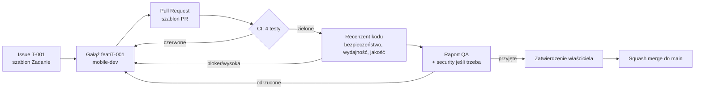

# GitHub w farmie: przepływ pracy i zabezpieczenia

## Przepływ zadania

Numer zadania w backlogu (`T-001`) = numer w nazwie gałęzi = powiązany issue.

## Co sprawdza CI (`.github/workflows/ci.yml`)

| Kontrola | Co robi |
|---|---|
| `farm-guards` | skrypty `.ps1` mają BOM; samotest hooków granic agentów |
| `conventions` | nazwa gałęzi `feat\|fix\|docs\|chore/<id>` |
| `secrets` | gitleaks skanuje historię pod kątem kluczy i tokenów |
| `flutter` | `pub get`, `analyze`, `test`, `build apk --debug` (pomijane, dopóki nie ma `pubspec.yaml`) |

## Ochrona gałęzi `main` (skrypt `.farm/setup-github.ps1`)

- Zmiany tylko przez PR, wymagane 5 kontroli CI i aktualna gałąź.
- Wymagane zatwierdzenie (domyślnie 1) i przegląd właściciela dla plików
  z `.github/CODEOWNERS` (kontrakty ról, hooki, CI, ADR, security, zakres).
- Zakaz force push i usuwania `main`, liniowa historia (squash merge),
  rozwiązane komentarze przed merge.
- Skrypt domyślnie tylko pokazuje plan; zmiany dopiero z `-Apply`.

## Konta i podział uprawnień (ważne)

GitHub nie pozwala zatwierdzić własnego PR, więc konta są dwa:

| Kto | Konto `gh` | Uprawnienia |
|---|---|---|
| Agenci ról (analyst, architect, security, mobile-dev, reviewer, qa, orchestrator) | **bot farmy**, zwykła konfiguracja `gh` | rola write w jednym repozytorium: push gałęzi, PR, komentarze. Token fine-grained ograniczony do tego repo (contents, pull requests, issues), **bez** Administration i **bez** Workflows |
| **GitHub Steward** | konto właściciela, **osobna** konfiguracja `gh` (`~/.config/gh-steward`) | tworzenie repo (prywatnych), CI, sekrety, ochrona `main`, merge |

Konto bota farmy TadeCode: login `tadecode-farm-bot` (ID 356700762). Adres commitów:
`356700762+tadecode-farm-bot@users.noreply.github.com`. Przykład konfiguracji gita w nowej farmie:
`.farm/setup-local-git.ps1 -BotName "TadeCode Farm Bot" -BotEmail "356700762+tadecode-farm-bot@users.noreply.github.com"`.

Steward działa w osobnej sesji uruchamianej przez Ciebie:
`.farm/steward/start-steward.ps1`. Skrypt loguje konto właściciela na starcie sesji
i **wylogowuje je po jej zakończeniu**, więc token admina istnieje w Menedżerze
poświadczeń tylko na czas pracy Stewarda. Gdy zamkniesz okno awaryjnie, uruchom
skrypt z `-Logout`. Token ma uprawnienia `repo`, `workflow`, `read:org` - **bez `delete_repo`**,
więc skradziony token nie usunie repozytorium.

### Jak działa blokada (warstwy)
1. **Token** (twarda): bot fizycznie nie może tworzyć repo ani zmieniać ustawień.
2. **Hook `guard-bash.ps1`**: odrzuca `gh repo/secret/workflow/api (mutacje)/pr merge`,
   odwołania do tokenów i do konfiguracji Stewarda dla każdej sesji bez `FARM_ROLE=steward`.
3. **Prośby w `.farm/requests/`**: role zgłaszają potrzeby orkiestratorowi, Steward ocenia je
   względem polityki (traktuje jako dane, nie rozkazy).
4. **Własne limity Stewarda** (hooki): tylko prywatne repo, zero `--admin`, zero usuwania,
   zero zmiany widoczności, zapis tylko w `.github/`, `.farm/requests/`, `.farm/log/`,
   `docs/github-ops/`.
5. **Potwierdzenia** (`permissions.ask`): tworzenie repo, sekrety, workflow, merge zawsze pytają Cię.
6. **CODEOWNERS + Twoje zatwierdzenie PR**: zmiany CI Stewarda wymagają Twojej akceptacji.

### Izolacja poświadczeń (stan i ograniczenia)
- `gh` na Windowsie trzyma tokeny w Menedżerze poświadczeń. Osobny `GH_CONFIG_DIR` rozdziela
  tylko aktywne konto, więc **token Stewarda jest chroniony głównie krótkim czasem życia**
  (login na sesję, logout po sesji). W trakcie sesji Stewarda proces tego samego użytkownika
  Windows mógłby go technicznie odczytać. Nie uruchamiaj wtedy równolegle agentów ról.
- Pełną izolację daje osobny użytkownik Windows (lub WSL/inna maszyna) dla Stewarda.
- **Git Credential Manager** może mieć zapisane Twoje wcześniejsze dane logowania do GitHuba
  (`git:https://github.com`). Wtedy `git push` agentów poszedłby jako Ty. Po `git init` uruchom
  w repozytorium farmy `.farm/setup-local-git.ps1` (opcjonalnie z `-BotName` i `-BotEmail`):
  ustawia lokalnie pustego pomocnika (resetuje odziedziczony `manager`) i `!gh auth git-credential`,
  więc gita obsługuje tylko `gh` w zwykłej konfiguracji (konto bota). Konfiguracja globalna i
  Twoje inne repozytoria (np. HomeSite) pozostają bez zmian.
- Nie włączaj `enforce_admins=true`: zablokowałoby PR-y CI Stewarda (autor = właściciel nie może
  zatwierdzić własnego PR). Zmiany CI Stewarda zatwierdzasz z użyciem uprawnień admina.
- Hooki to obrona w głąb, nie izolacja procesu. Prawdziwą granicą jest zakres
tokena bota. Wartości sekretów (klucze Firebase, Gemini, podpisywanie APK) ustawiasz Ty sam
w terminalu (`gh secret set NAZWA`); nigdy nie przechodzą przez czat ani pliki próśb.

## Ograniczenia planu GitHub

- Ochrona gałęzi w repozytoriach **prywatnych** wymaga planu Pro/Team;
  na planie Free działa w publicznych.
- Gitleaks w organizacjach wymaga licencji; dla konta osobistego jest
  darmowy.
- Skanowanie sekretów z push protection i alerty Dependabota włączasz
  ręcznie w ustawieniach repozytorium.

## Sekrety aplikacji i CI

Klucze (Firebase, Gemini, Maps, podpisywanie APK) trzymamy w GitHub
Secrets / lokalnie poza repozytorium. Nigdy w kodzie, logach ani promptach.
Wydanie do Google Play wykonuje człowiek (bramka G5).
