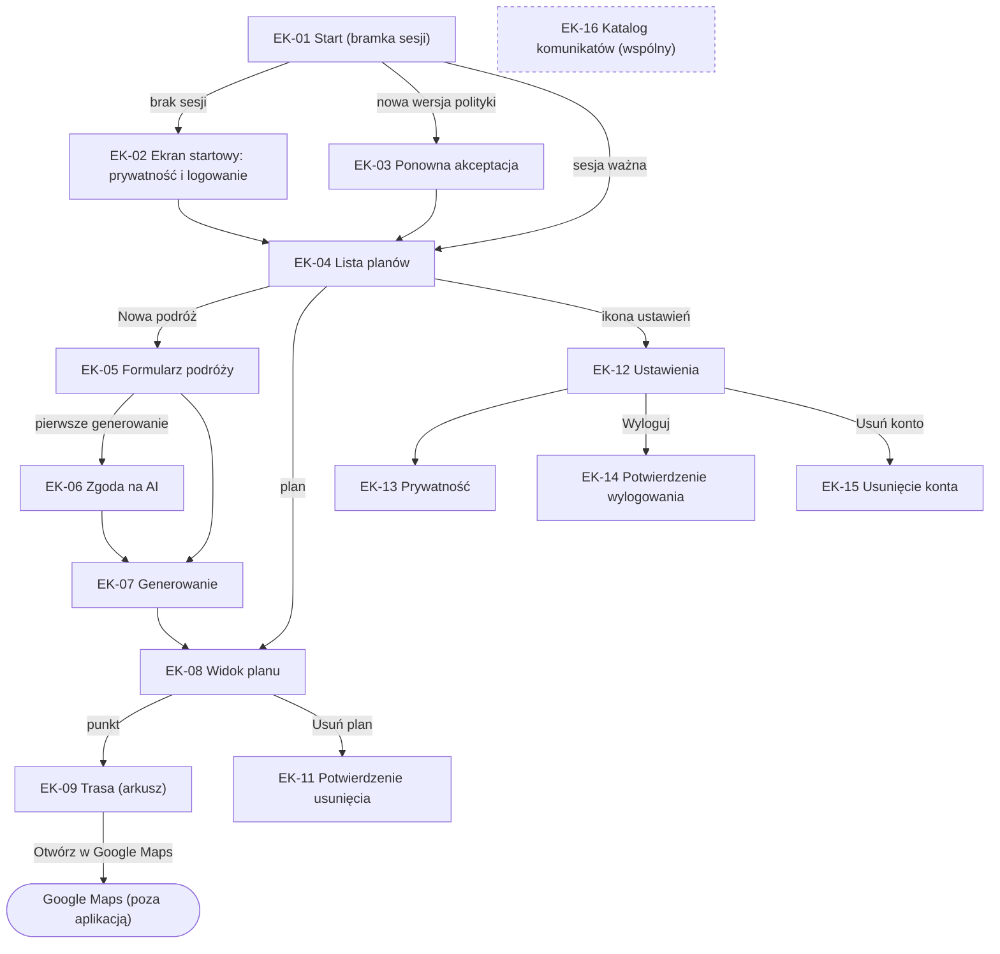
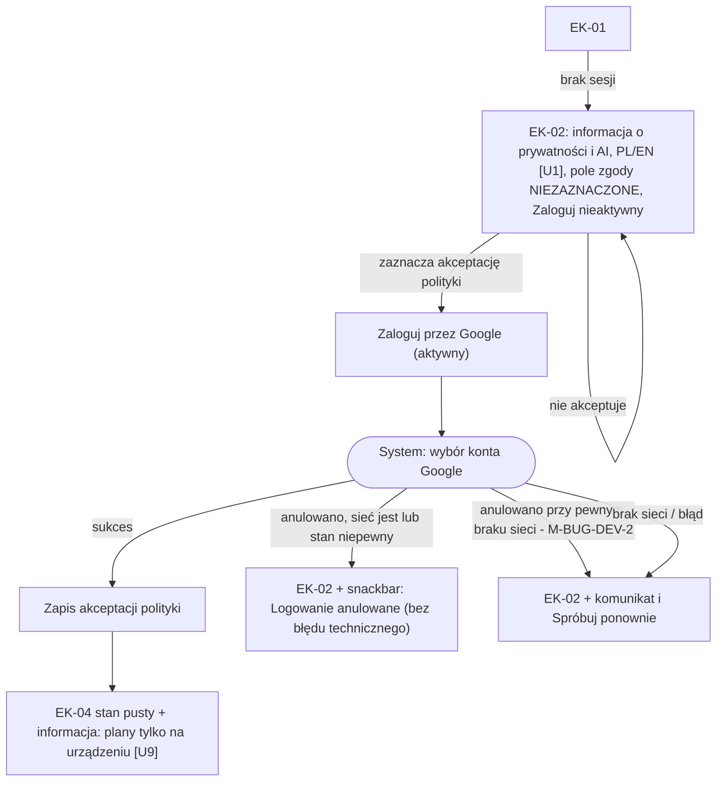
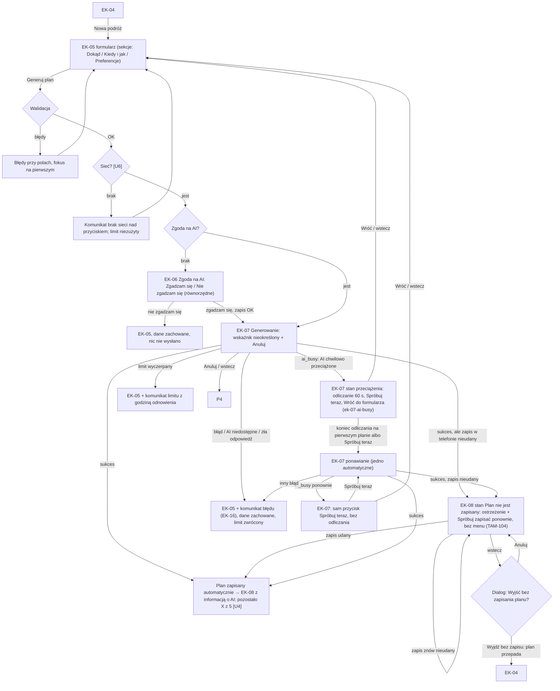
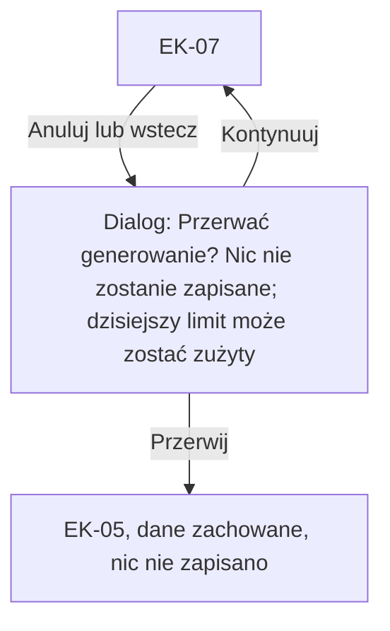
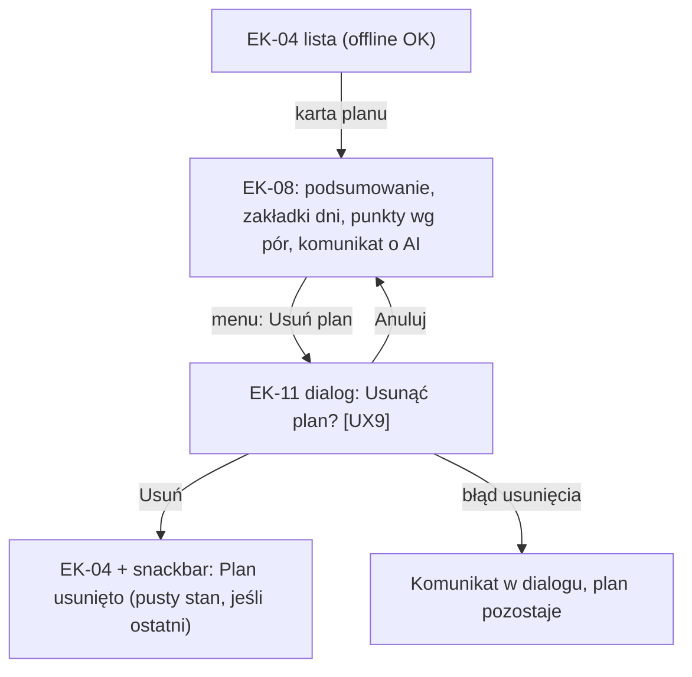
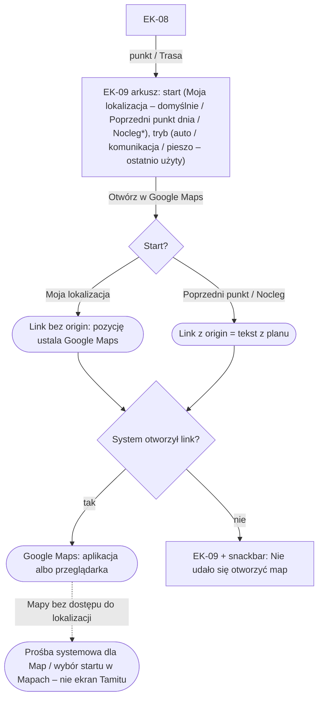
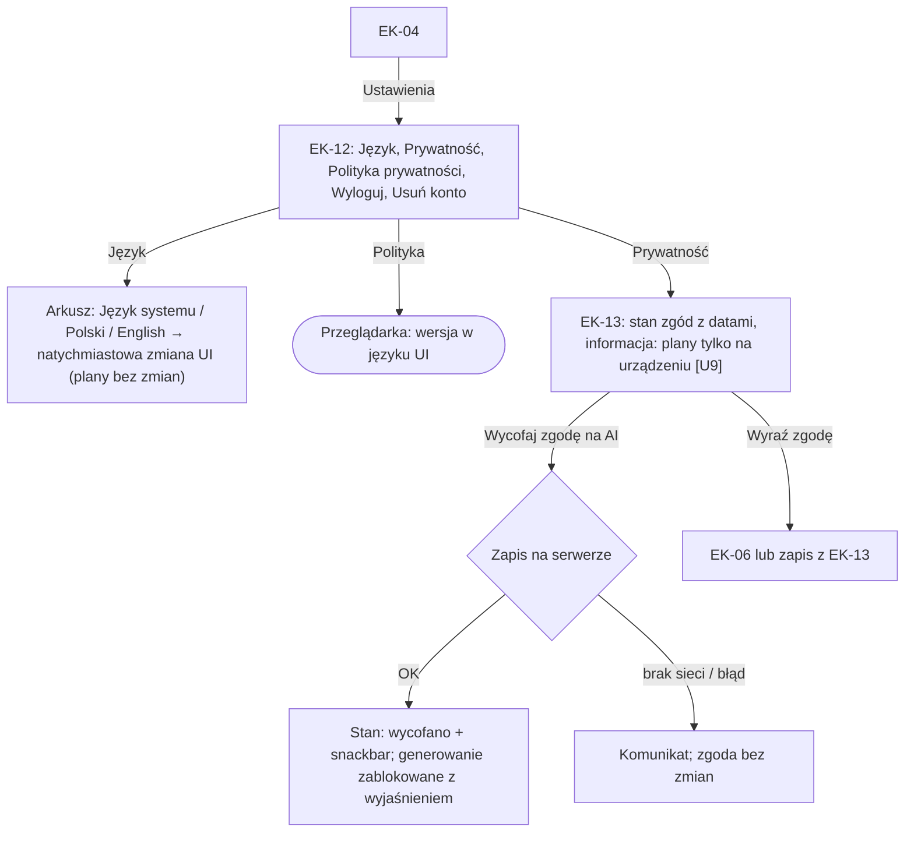
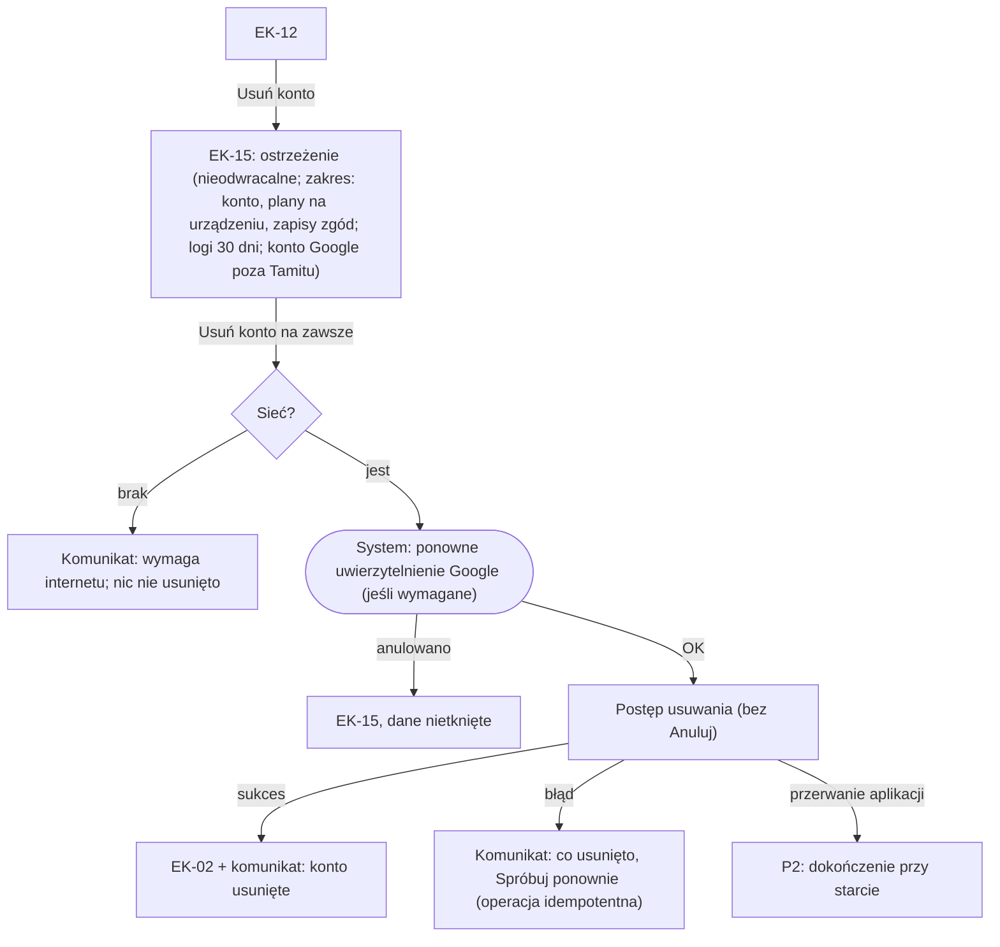

# Przepływy użytkownika – Tamitu (MVP)

- Status: szkic, wersja 0.1 (2026-11-16, ux, P3-14b krok 1)
- Źródło: `docs/requirements/screens-and-flows.md` (P3-14a: EK-01..EK-16, P1–P10, macierz stanów). Ten dokument
  przekłada przepływy na diagramy i przypisuje im wzorce (`patterns.md`). **Nie zmienia wymagań**; rozbieżności
  zgłaszam jako pytania.
- Do czasu odpowiedzi na U1–U15 obowiązują propozycje domyślne analityka; miejsca zależne od pytań oznaczone `[Ux]`.
- Oznaczenia: prostokąt – nasz ekran; `([…])` – element systemu (Android/Google); romb – decyzja.

## 0. Mapa aplikacji



Nawigacja: brak dolnego paska (2 cele najwyższego poziomu); Ustawienia z paska górnego EK-04 (`layout.md` pkt 3).

## P1. Pierwsze uruchomienie (US-001, US-003) – wzorce: pierwsze uruchomienie, zgody



Zgoda na AI **nie** jest pytana w P1 (privacy-checklist pkt 2). Informacja o pełnoletności na EK-02 [U2, PRAWNIK].

## P2. Powrót zalogowanego użytkownika (US-001, US-003, US-010; ADR-0005 Aneks A pkt 2, ADR-0011 pkt 1, 8, 9)

```mermaid
flowchart TD
  A["EK-01 (systemowy ekran powitalny, bez migotania)"] --> B{"Stan"}
  B -->|sesja ważna, także offline| C["EK-04"]
  B -->|wersja polityki w aplikacji nowsza niż akceptacja (offline)| D["EK-03 blokujący: Akceptuję / Wyloguj / Usuń konto [U2]"]
  D -->|Akceptuję, wymaga sieci| C
  B -->|znacznik: usuwanie w toku| R{"Konto na serwerze? (reload)"}
  R -->|usunięte| E["Czyszczenie lokalne"] --> F["EK-02 + komunikat"]
  R -->|istnieje| K["Dokończ usuwanie / Anuluj usuwanie"]
  K -->|Dokończ| Q["EK-15 (ponowne logowanie)"]
  K -->|Anuluj| C
  R -->|brak sieci| N["Połącz się, aby dokończyć + Spróbuj ponownie"]
  B -->|baza nieczytelna: utrata klucza| G["Usunięcie pliku, pusta baza, jednorazowy dialog"] --> H["EK-03 wariant: dane wyczyszczone"] --> I["EK-04 pusty"]
```

## P3. Tworzenie planu (US-004, US-005, US-006, US-011) – wzorce: formularz, zgody, ładowanie, błąd z ponowieniem



## P4. Anulowanie generowania (US-005, US-011, Q12) – wzorzec: potwierdzenie działania destrukcyjnego



## P5. Lista, podgląd i usuwanie planów (US-008, US-009) – wzorce: lista i szczegóły, potwierdzenie



## P6. Trasa (US-007; wariant C z Q1, 2026-11-25) – wzorzec: arkusz dolny do wyboru



* start „Nocleg” z informacją o przybliżonym punkcie [U14]; bez noclegu w planie pozycja jest ukryta; „Poprzedni punkt dnia” ukryty przy pierwszym punkcie dnia (UX-TAM108-1). Przy domyślnym starcie wystarczy jedno dotknięcie. Tamitu nie
prosi o lokalizację i nie odczytuje pozycji (EK-10 wycofany). Brak sieci obsługuje Google Maps (ADR-0011 pkt 2).

## P7. Ustawienia, język, prywatność (US-003) – wzorce: lista i szczegóły, zgody



EK-13 nie pozwala „wycofać" akceptacji polityki [U15]; drogą jest usunięcie konta.

## P8. Wylogowanie (US-002)

```mermaid
flowchart TD
  A["EK-12"] -->|Wyloguj| B["EK-14 dialog: plany zostają na urządzeniu, wrócą po zalogowaniu tym kontem, inne konto ich nie zobaczy [U7]"]
  B -->|Wyloguj, działa offline [U8]| C["EK-02"]
  B -->|Anuluj| A
```

Wylogowanie niedostępne w trakcie generowania – EK-07 jest modalny [U8].

## P9. Usunięcie konta (US-010) – wzorzec: potwierdzenie działania destrukcyjnego (pełny ekran)



## P10. Limity i błędy (US-011) – wzorce: błąd z ponowieniem, brak sieci

```mermaid
flowchart TD
  A["Akcja Generuj plan"] --> B{"Wynik"}
  B -->|limit 5/dobę| C["Komunikat limitu z godziną odnowienia (czas lokalny); reszta aplikacji działa"]
  B -->|błąd usługi / sieci / zła odpowiedź| D["Komunikat EK-16 bez szczegółów; formularz zachowany; ponowienie z decyzji użytkownika"]
  B -->|limit globalny / wyłącznik kosztowy| E["Usługa chwilowo niedostępna (bez ujawniania powodu)"]
  B -->|wymagana aktualizacja [U3]| F["Stan: Zaktualizuj aplikację + link do sklepu"]
```

## Śledzenie: przepływ → ekrany → wzorce

| Przepływ | Ekrany | Wzorce (`patterns.md`) |
|---|---|---|
| P1 | EK-01, EK-02, EK-04 | 9, 8, 3 |
| P2 | EK-01, EK-03, EK-04, EK-02 | 8, 5 |
| P3 | EK-04, EK-05, EK-06, EK-07, EK-08, EK-16 | 2, 8, 4, 5, 6 |
| P4 | EK-07, EK-05 | 7 |
| P5 | EK-04, EK-08, EK-11 | 1, 7, 12 |
| P6 | EK-08, EK-09 | 11 |
| P7 | EK-12, EK-13, EK-06 | 1, 8, 11 |
| P8 | EK-12, EK-14, EK-02 | 7 |
| P9 | EK-12, EK-15, EK-02 | 7, 4, 5, 6 |
| P10 | EK-05, EK-07, EK-16 | 5, 6 |
